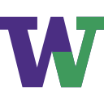

<p align="center">
  
</p>

<h1 align="center">UWCheck</h1>

<p align="center">
  <b>One calendar and to-do list for every UW deadline: Canvas, Ed and CSE course websites.</b>
</p>

<p align="center">
  
  
  
  
</p>

<picture>
  <source media="(prefers-color-scheme: dark)" srcset="docs/screenshot-dark.png">
  
</picture>

## Why

At UW, deadlines are spread across Canvas, Ed lessons and course websites, and each one shows only part of the picture. UWCheck pulls them all into one place, removes duplicates, and lets you tick things off.

- **Every course in one view.** Canvas assignments, quizzes and events, Ed lessons (readings, lectures, labs, homework) and UW CSE `assignments.html` pages.
- **Removes duplicates.** When a CSE course lists `HW4` on both Ed and its website, you see it once.
- **Shows what's coming.** Work listed on the course website but not yet released on Ed appears as a dashed preview.
- **Month and week views**, an overdue / today / upcoming to-do list, course colours, filters, your own deadlines, light and dark themes, and a Local / Seattle time-zone toggle.
- **Private by design.** A small local server with no dependencies. Your tokens and ticks are stored only in `data/` on your computer and never leave it.

## Quick start

You need [Node.js](https://nodejs.org) 18 or newer (the LTS download is fine).

```sh
git clone https://github.com/n473CL0/uwcheck.git
cd uwcheck
npm start
```

Your browser opens at <http://localhost:7351>, along with **Settings**:

1. **Canvas calendar feed URL.** In Canvas, open **Calendar**, then click **Calendar Feed** (bottom right) and copy the link. This covers every Canvas course.
2. **Ed API token** *(optional)*. Create one at [edstem.org → Settings → API Tokens](https://edstem.org/us/settings/api-tokens). All of your active Ed courses are picked up automatically.

Click **Save & sync**. That's all the setup there is.

> **No terminal?** On Windows, download the ZIP from GitHub, unzip it and double-click **`Start Dashboard.bat`**. On macOS/Linux, run `./start.sh`. Keep the window open while you use the dashboard, and close it to stop.

## Using it

| | |
|---|---|
| **Tick off work** | Use the checkboxes in the to-do list, or click any item on the calendar. |
| **Hide a course** | Click it in the legend. Click its coloured dot to change the colour. |
| **Filters** | Hide assignment types, or show completed and unreleased items. |
| **Add your own** | Use **+ Add**, or the **+** on any calendar day. |
| **Views** | Month / Week. Week view shows full titles. In month view, click **+N more** to see a busy day. |
| **Time zone** | **Local** follows your computer. **Seattle** shows UW time, which is useful when you're travelling. |
| **Keyboard** | <kbd>←</kbd> <kbd>→</kbd> move by a month or a week, <kbd>T</kbd> goes to today, <kbd>M</kbd> / <kbd>W</kbd> switch views. |

It syncs on launch, every 30 minutes, and whenever you click **Sync**. The dot next to each source in the header is green when it's connected, orange when it isn't set up yet, and red when the last sync failed. After a failed sync, the last good copy stays on screen.

## Optional settings

Under **Settings → Advanced**:

- **Ed courses:** leave this empty to include every active course. To limit or rename courses, add `course id = name` lines. The id is the number in `edstem.org/us/courses/107500/lessons`.
- **Course websites:** UW CSE courses publish an `assignments.html` page that often lists work before it's released on Ed. Add one per line, for example
  `https://courses.cs.washington.edu/courses/cse351/26au/assignments.html = CSE 351`
- **Canvas course names:** course names are read from the feed. To shorten one, add `canvas course id = name`.

To use another port, set `PORT` before starting, for example `PORT=8080 npm start`.

## How it works

```
Canvas .ics feed ─┐
Ed lessons API ───┼─▶ server.js ─▶ merge + dedupe ─▶ data/cache.json ─▶ public/index.html
Course websites ──┘   (Node, no dependencies)         (last good copy)    (one-file UI)
```

- **`server.js`** fetches each source, normalises course codes (`MATH/STAT 394 A` becomes `MATH 394`, `E E 201` becomes `EE 201`), handles Seattle time zones and daylight saving without any libraries, and serves a small JSON API.
- **`public/index.html`** is the whole interface in one file: plain HTML, CSS and JavaScript, with no build step.
- **`data/`** is created on first run and is git-ignored. It holds `config.json` (your feed URL and token), `state.json` (ticks, colours, custom tasks) and `cache.json`.

## Privacy

UWCheck listens only on `127.0.0.1`, so nothing else on your network can reach it. Your Canvas feed URL and Ed token are stored in plain text in `data/config.json` and are sent only to Canvas and Ed. Treat that folder like a password: don't commit it or share it. The included `.gitignore` already excludes it.

## License

[MIT](LICENSE). Not affiliated with or endorsed by the University of Washington, Instructure or Ed.
