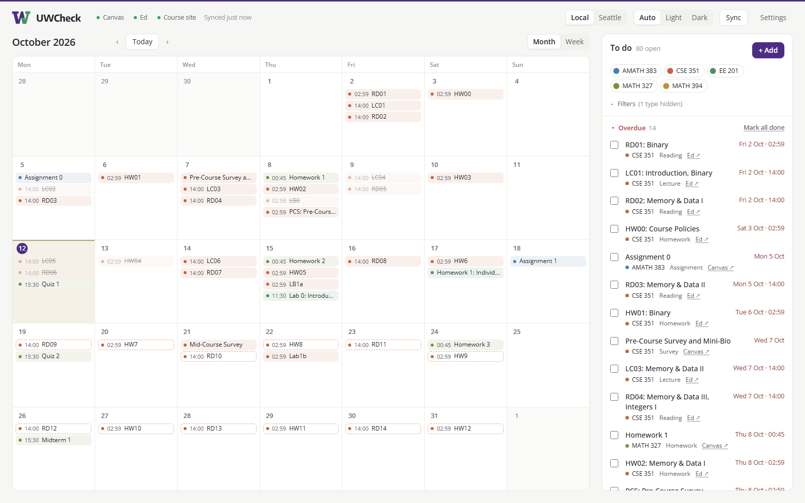

<p align="center">
  
</p>

<h1 align="center">UWCheck</h1>

<p align="center">
  <b>One calendar and to-do list for every UW deadline: Canvas, Ed and CSE course websites.</b>
</p>

<p align="center"><a href="https://n473cl0.github.io/uwcheck/">n473cl0.github.io/uwcheck</a></p>

<picture>
  <source media="(prefers-color-scheme: dark)" srcset="docs/screenshot-dark.png">
  
</picture>

## Install

1. Install [Node.js](https://nodejs.org) (the LTS version).
2. Open a **new** terminal window (on Windows, **Command Prompt**: PowerShell may refuse to run `npx`) and run:

   ```sh
   npx uwcheck@latest --install
   ```

   If it asks `Ok to proceed?`, press <kbd>Enter</kbd>.

   On Windows, if you see `running scripts is disabled on this system`, you're in PowerShell: type `npx.cmd` instead of `npx`, or open Command Prompt.

3. UWCheck opens on **Settings**. Fill in:
   - **Canvas calendar feed URL:** in Canvas, open **Calendar**, click **Calendar Feed** (bottom right), and copy the link.
   - **Ed API token** *(optional)*: create one at [edstem.org → Settings → API Tokens](https://edstem.org/us/settings/api-tokens).
4. Click **Save & sync**.

That's it. From now on, open **UWCheck** like any other app: search for it in the Start menu, Spotlight or your app launcher (on Windows it's on your desktop too). It runs in the background, so you can close the terminal. When an update is out, an **Update** button appears in the header.

| Command | What it does |
|---|---|
| `npx uwcheck@latest --install` | Run again if the app ever stops opening, for example after reinstalling Node.js. |
| `npx uwcheck@latest --stop` | Stop the background server. |
| `npx uwcheck@latest --uninstall` | Remove the app. Your settings are kept. |
| `npx uwcheck@latest` | Use UWCheck without installing the app. Keep the terminal open while you do. |

## Optional: course websites

UW CSE courses often list work on their `assignments.html` page before it's released on Ed. Add them under **Settings → Advanced**, one per line:

```
https://courses.cs.washington.edu/courses/cse351/26au/assignments.html = CSE 351
```

The same panel lets you limit or rename Ed and Canvas courses (`course id = name`).

## Privacy

Everything runs on your computer and listens only on `127.0.0.1`. Your Canvas feed URL and Ed token are saved in `~/.uwcheck/config.json` and sent only to Canvas and Ed. Treat that folder like a password.

## Running from source

```sh
git clone https://github.com/n473CL0/uwcheck.git
cd uwcheck
npm start
```

## Contributing

Want UWCheck to read deadlines from another tool your courses use? Each source is one small file. See [CONTRIBUTING.md](CONTRIBUTING.md).

## License

[MIT](LICENSE). Bundled fonts are under the [SIL Open Font License](public/fonts/OFL.txt). Not affiliated with the University of Washington, Instructure or Ed.
